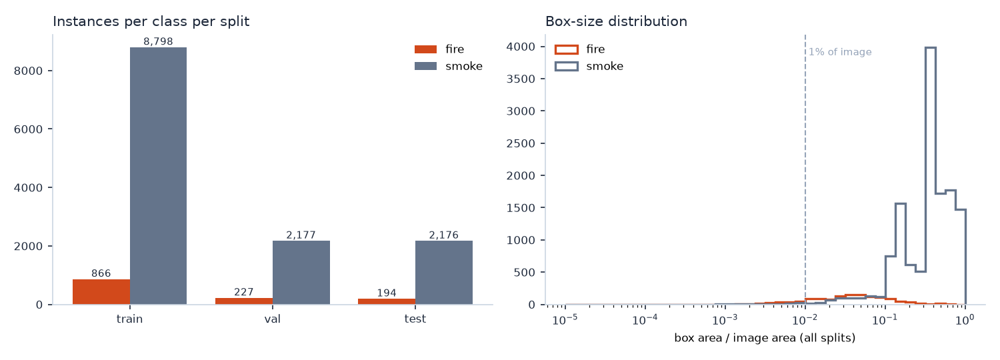
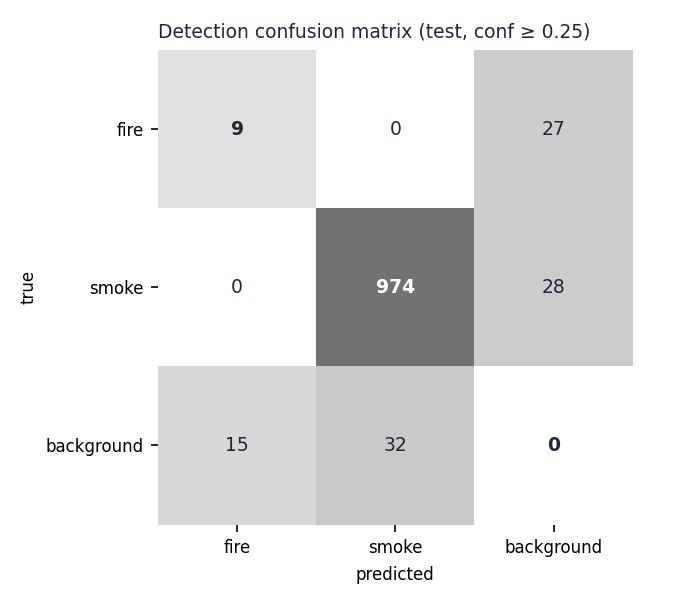
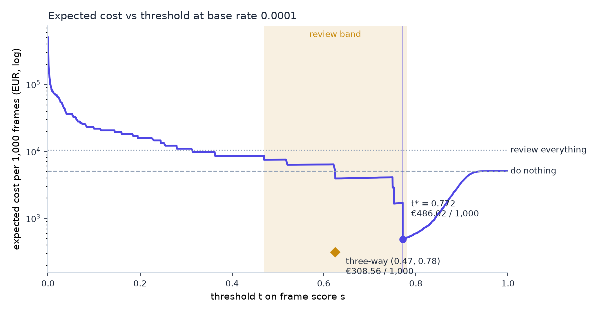

# Assignment 2 Report: Fire and smoke detection for cameras

- **Name**: Jimena Sánchez
- **Student ID**: 20104
- **Email**: jsanchezcurt.ieu2022@student.ie.edu
- **Group**: PPLEDBA 5A

## Business problem, and the cost of being wrong

For this assignment, I assumed I was an fire and smoke alarm receiving center monitoring 200 indoor cameras in common areas of residential care homes, houses and so on. Each camera sends one frame per minute, with our data set the center receives 288,000 frames per day. 

For each frame, the model may do three things (multi class classification). It may pass review or alarm. A pass means no action is taken. A review means that a human operator will receive the frame alongside its previous one and we'll decide whether to pass or alarm. Finally if the model decides to alarm, it means that the center runs. It's fire protocol straight away, calling 112 and alerting night staff. 

Although we hold this multi class classification, in terms of decision level, it gets collapsed into a binary. A positive frame is one that contains smoke or flame well, the negative is one that contains neither. Once a fire has been alarmed it becomes handled by a person and leader frames no longer go through the decision. This decision is based on the fact that we are monitoring places like care homes where residents often cannot evacuate themselves and staff is usually not enough to do the evacuation securely, which means that older group people are the most likely to die in building fires. We know that in reality ceiling smoke detectors are mandatory but in large rooms they often react late. Seeing smoke earlier gives a person a headstart. Thus, the business frame is not to replace detectors, but rather to decide which of the 288,000 frames a day deserve a human check.

In terms of the cost of mistakes, there is a clear asymmetry. On the one hand, false negatives (missed fire frames). These are assigned a cost of 50,000. One frame equals one minute, so a positive frame starts the response one minute later. Domestic fires furnished rooms can go from a first flame to flashover in about five minutes. On the other hand, we assigned the cost of a false positive (false alarm) a cost of 500. This essentially represents the cost of running the entire protocol for nothing. Although there is a clear opportunity cost associated with this (ranging from nothing to the cost of a life. If had that dispatch not been called they could've saved someone who was really in danger), lives are always a priority, so it is important that the ratio of cost between false negatives and false positives represent a sort of catastrophic versus 'only money, so in some way cheaper scenario. I also associated a cost to the true positive, which is the correct alarm. This is associated to the one frame per minute structure, even if we catch the fire quickly that minute can still can be a cost. However, a cost of zero was assoc assigned to a correct pass. Furthermore a review costs to the model's eyes 0.14 dollars. This term from a simple operation. We assume an average of 20 seconds wasted by an operator that is charging 25 per hour.

The status that has a particularity, which is the growth aspect of what we are measuring. Fire does not exist, isolated in one frame, but appears in one and would most likely if not intervened results in smokier and more fiery frames following it. Thus we may catch it at different points, and I associated a cost to this. A model that catches the first smoke costs, the rooms, contents, and possibly cleaning. I assumed it cost of 10,000 for this. If a model only catches it after a flash over, it may cost part of the building, the evacuation and security risks that come from the homes closure and so on and so for this we assigned a $250,000 cost. This last cost is associated to the cost of a false negative as the 240,000 difference over five minutes (which is the average time we assume it takes a room to go from a first flame to a flashover) is about $50,000 per minute of delay.

This means that according to our cost structure, a misfire alarm costs 100 times more than a false alarm. That ratio is why the pass threshold sits so low, why there is a review band instead of just a single threshold why operators are told to if in doubt, escalate and why I focused on recall of positive class before precision when evaluating this model. 

It is worth noting the possible issue of double counting, and how it was handled. A fire stays in front of a camera for many minutes. If misses were independent, a model that caught only 60% of positive frames would still catch 94 of frames within three minutes, yeah, I still price every missed frame at a full 500,000. This decision is based on two justifications. First that positive classes are defined as unhandled minutes so each mist frame really means one more minute of fire growth frames after an alarm are not counted so we're avoiding a double billing problem in this aspect. The second comes precisely from the fact that misses are not independent. The model misses for reasons that last within frames. For example, real instead of synthetic imagery, small or distant smoke darkness of the night and so on. On the test that it's recall at the chosen threshold is 97 of the composed in indoor smoke 32 on real fire photos and 0 of 14 unreal video frames. A fire that messes a minute one is likely to be missed again at two. Per frame recall is therefore a pessimistic yet fair measure of how fast a fire is caught.

Overall, the evidence of the value we offer regarding the The business problem is obvious. Without it, the alternative is to have a person watching every frame (meaning 288,000 a day about 246 full-time operators which include a high cost) or to have nobody watching and depend only on ceiling detectors. With solution operators look at about 1.5% of frames and the center still reacts to most fire within minutes.

## Dataset

- **Workspace / project / version:** `dangerzone-6iqvs` / `smoke_fire-idefg` / version `5`. Link: https://universe.roboflow.com/dangerzone-6iqvs/smoke_fire-idefg/dataset/5. 

Regarding the classes, we have a binary structure where a 0 represents a fire and 1 represents smoke. Because this is an object detection task the background is a free negative class. It is at the decision level where I merge these two classes and I make a frame positive if it contains at least one fire or smoke box because the business action following, it is similar.

In this project, one still is treated as one camera frame of a minute interval. In practice, the data contains four sources stitched together with file names telling them apart, which made me have to solve for possible data leakage. The first file name structure type composes, a 77% of the total data set and shows indoor rooms such as bedrooms, dining rooms and lounges with smoke composited at high, medium or low densities. This type of image contains only smoke never fire. The second type represents a 16% and shows every day web photos of people, food, objects, and so on they are almost all unlabeled and negative. Finally, the third type represents a 6% and contains real news style photos from fires. They are almost all labeled with a fire box. There is a fourth type with video frames from fire videos assorted into web pictures, but they represent a one percent of the data set.

I chose this dataset because they resemble the scenes. My camera sees the first type that contains furnished indoor rooms, especially, with cases of faint smoke, which is what the early stage decision is all about. Moreover, the dataset is public and large enough to fine-tune on, containing 10,296 training images.

There are two issues, however, with the data set that must be noted. First, the smoke is synthetic. It has a uniform structure and soft edges that real smoke may not resemble. Secondly, the negatives are not what my camera sees. When nothing is wrong. The camera would see an empty lounge at night steam from a food, trolley or dust in a sunbeam. However, the data sets negatives are holiday snapshots so nothing in them is too hard to reject.

Regarding the split of the data for the model, the following decisions were made:

| Split | Images | Background (no labels) | Fire only | Smoke only | Both | Neither fire nor smoke | Fire-or-smoke prevalence |
|---|---|---|---|---|---|---|---|
| train | 10,296 | 1,689 (16.4%) | 309 | 8,097 | 201 | 1,689 | 83.6% |
| val | 2,573 | 411 (16.0%) | 80 | 2,037 | 45 | 411 | 84.0% |
| test | 2,570 | 413 (16.1%) | 70 | 2,045 | 42 | 413 | 83.9% |

| Instances | train | val | test |
|---|---|---|---|
| fire | 866 | 227 | 194 |
| smoke | 8,798 | 2,177 | 2,176 |

| Box area / image area | Boxes (all) | Median | IQR (Q1–Q3) | Share < 1% | Test median | Test share < 1% |
|---|---|---|---|---|---|---|
| fire | 1,287 | 3.71% | 1.67%–7.52% | 13.1% | 3.67% | 17.5% |
| smoke | 13,151 | 37.52% | 19.05%–55.22% | 0.6% | 35.56% | 0.5% |

- Test-set prevalence of fire-or-smoke frames: 83.9%.
- Low-count flag (< 100 test instances): none.

**Unique source images** (augmented copies share one): train 3,064 of 10,296 frames, val 2,371 of 2,573, test 2,370 of 2,570.

**Split overlap:** 299 source images appear in both train and test (434 test frames); train–val 292; val–test 244.

In our split, the fire is the thin class. For example, in the test split there are 2176 smoke boxes and only 194 fire boxes and those fire boxes come from only 112 frames. This could potentially be fixed with methods to address unbalance of classes, but it falls outside of the scope. Moreover, there is a disparity in frequency that must be noted. Test prevalence is 83.9% while the production base rate is 0.01%. In other words, positive classes are about 8000 times more common in the test then on real cameras. Therefore there are limitations when translating accuracy and precision measured on the test set onto production. Thus the pipeline only uses the test set to measure recall and false positive rate, and we reweight them to the base rate before costing anything.

To expand on an important flaw of the data set that was noted before, the dataset's file naming structure coincides almost perfectly with the labels. The model never reads the file name, but the name marks which source an image comes from, and each source has its own look (composited rooms, holiday snapshots, news photos), so the model could learn to recognise the source instead of the smoke. This was tested and a rule that read only the file name reached 99.6% accuracy. Thus I modified `train.py` to crop the largest region that stays 5% clear of every box and added it as a background frame in the same split. This means that every family now has both labels and the file name rule dropped to 73% on accuracy by alarming on 85% of the clear test frames. The pipeline also reports the ROC AUC within each family, which shows whether the model sees smoke rather than the source; that number needs the retrained model (see the status note below). However, we must anticipate that a few crops may be mislabeled given partial view of the scene or the fact that faint smoke can spill past its box

Roboflow made about three augmented copies of each training photo and 299 source pictures ended up in both train and test, so I re-split by source photo. Our pipeline now groups every copy by its source and re-splits the 7139 source photos into a 70 15 15 split, stratifying by source, family, and label and keeping one copy per source in val and in test. No source photo appears in more than one split.

Regarding the status of this fix, it is implemented in `train.py` (it runs by default) and it was checked on the data, where no source photo is shared between splits anymore (down from 299) and the file name rule falls from 99.6% to 73% accuracy. However, the model in `weights/best.pt` and every result that follows were trained and tested on Roboflow's original split, before this fix, so they still carry the leak and the shortcut described above, and the tables in this section describe that original split. It is also worth noting that after the re-split the test set keeps only 36 fire boxes in 17 frames, because most of the original 194 were copies of training photos. Thus, retraining with the fix is the first next step, as explained in the limitations.

## Finetuning and baselines

For this task I used yolo11n (nano) for object detection, fine-tuned from COCO weights. Object detection was better suited than classification given that the operator needs to see where the smoke is in order to judge it in 20 seconds, and the dashboard draws the boxes. I chose the nano version because I trained on a laptop (Apple M4, MPS), where 30 epochs took 18.3 hours over two sessions (the run was interrupted and resumed). In production, one frame per minute from 200 cameras is a light load, so a small model can run on a cheap machine at the alarm center. The price of this choice is a weaker detection of small objects, which matters for early smoke.

Regarding the hyperparameters, the following were chosen: 640 px images, batch 16, AdamW (learning rate 0.001667, momentum 0.937), seed 0, 30 epochs and patience 10, with the default Ultralytics augmentation (mosaic 1.0, horizontal flips 0.5 and brightness 0.4). The model trained on 10,296 images with Python 3.12.12, torch 2.11.0 and ultralytics 8.4.173, and the full settings are saved in `weights/run_meta.json`. The best epoch was the last one (30), with a validation precision of 0.844, a recall of 0.789, an mAP50 of 0.840 and an mAP50-95 of 0.573. This means that validation was still improving, so the model is probably undertrained.

To evaluate it, I compared the fine-tuned model against four baselines on the same test split, at frame level and with costs computed at the production base rate:

| Model or policy | mAP50 | Frame recall | Frame FPR | Cost per 1,000 frames | TP/FN/FP/TN (test) |
|---|---|---|---|---|---|
| Fine-tuned model alone (threshold 0.772) | 0.824 | 91.2% | 0.0% | €486.02 | 1967/190/0/413 |
| COCO zero-shot | 0.000 | 0.0% | 0.0% | €5,000.00 | 0/2157/0/413 |
| Predict nothing | 0.000 | 0.0% | 0.0% | €5,000.00 | 0/2157/0/413 |
| Always alarm | n/a | 100.0% | 100.0% | €500,000.00 | 2157/0/413/0 |
| Source-only rule (file name, no pixels) | n/a | 99.9% | 1.9% | €9,738.85 | 2155/2/8/405 |

On the one hand, the COCO zero-shot model has no fire or smoke class, so it never raises an alarm and behaves exactly like predicting nothing, which costs €5,000 per 1,000 frames in missed fires. What it does detect on positive frames (at a confidence of 0.25) are cars (271), chairs (242), people (215), beds (104) and couches (88), which confirms that the scenes are mostly furnished rooms. On the other hand, fine-tuning takes mAP50 from 0 to 0.824. At the cost-optimal threshold the model catches 91.2% of positive frames with zero false alarms on the 413 negatives, for €486 per 1,000 frames, which is about a tenth of doing nothing. Always alarming costs €500,000 per 1,000 frames because every frame triggers a €500 response.

Regarding whether the gap is as large as I expected, it is larger, and that makes me suspicious rather than pleased. The file name rule explains why, since with no pixels at all it reaches 99.9% recall against the 91.2% of my model. It only loses on cost (€9,739 per 1,000 frames) because it alarms on all 8 smoke-free video frames (video frames are mostly positive in training) and it has no threshold to tune. The model clearly learned something real, given that COCO scores 0 and the fine-tuned model 0.824. However, this test split cannot show how much of that is smoke and how much is image source, so the headline gap over the baselines overstates what I would get on real cameras.

## Per-class evaluation and failure modes

Regarding the per-class results, the positive class is a frame that contains fire or smoke (any ground truth box of either class). Overall, the model reaches an mAP50 of 0.824 and an mAP50-95 of 0.574 on the test split, and smoke carries this headline number while fire drags it down. Smoke has a precision of 0.990, a recall of 0.938, an AP50 of 0.979 and an AP50-95 of 0.805 over 2,176 test instances, while fire has a precision of 0.804, a recall of 0.577, an AP50 of 0.669 and an AP50-95 of 0.343 over 194 instances. Precision and recall are measured at the single confidence that maximises the mean F1 (which is the Ultralytics convention), while AP does not depend on a threshold.

At frame level the gap is even larger. At the chosen model-alone threshold (0.772), smoke frames are caught 93.6% of the time but fire frames only 13.4% (15 of 112). Fire boxes are smaller and get lower confidence, so most fire frames score between 0.47 and 0.78. In other words, they do not trigger an alarm on their own, but they do land in the review band, where 77.7% of fire frames reach a person. Thus, for fire, the design depends on the human reviewer.

In terms of what the model confuses with what, the confusion matrix at a confidence of 0.25 shows that fire and smoke are almost never confused with each other (1 box out of 2,370), and confusing them would not matter anyway because both lead to the same action. The real failure is missed objects, since 64 of the 194 fire boxes (33%) and 97 of the 2,176 smoke boxes (4.5%) are not detected at all. The background row (89 fire and 93 smoke boxes predicted where no box exists) is mostly extra or misplaced boxes inside images that do contain smoke, given that only 6 of the 413 clean frames are flagged even at the review threshold. This means that this row reflects a localisation problem rather than false alarms on clean rooms.

Moreover, the model breaks by image source rather than by class. At the chosen threshold it catches 97.1% of the composited indoor smoke frames, but only 31.8% of the real fire photos, 0 of the 14 real video frames and 0 of the 10 other web images. The model is therefore very good at the synthetic smoke it was mostly trained on and poor on real imagery, which is precisely what production will be.

It is also worth noting the smoke false positives that I expect in production but cannot measure here, such as steam from food trolleys or showers, dust in sunlight, fog on windows, the glare of a lamp at night, or the cigarette or vape of a resident. None of these appear among the test negatives.

Overall, regarding whether the model beats both baselines where it matters, it does on cost and on catching positives, at €486 per 1,000 frames against €5,000 for both COCO and doing nothing. However, against the pixel-free source rule it loses on recall, which is the honest measure of how much this test set can prove.

## Cost matrix and operating point

In terms of costs, as derived in the business section, a false negative costs €50,000, a false positive €500, a true positive €500, a true negative nothing and a review €0.14 per frame (20 seconds of an operator charging €25 per hour). This puts the ratio between false negatives and false positives at 100 to 1.

Regarding the base rate, I assumed 0.0001, meaning that 1 frame in 10,000 shows an unhandled fire. That is 28.8 positive frames a day across 200 cameras, or roughly six incidents a day lasting about five unhandled minutes each, which is one incident per camera per month. This figure is deliberately high, since it counts every smoke or flame event that the protocol requires acting on and not only the fires that would become disasters (for example a smouldering bin, an overheating appliance, a cigarette dropped on a chair or a pan fire in a kitchenette). I could not find a measured rate per camera minute for the common areas of care homes, so this is the input I trust least. The rest of the inputs are 200 cameras sending 1,440 frames a day each (288,000 in total), 6.5 productive hours out of 8 paid hours per operator per day, a floor of 4.2 full-time operators to keep one seat staffed 24/7, and 5 operators available. For human review, I assumed that operators escalate 95% of real fires and 2% of frames with no fire.

Regarding the sweep, the model-alone cost curve is lowest at a threshold of 0.772, at €486 per 1,000 frames (with a 95% confidence interval from €431 to €546, from 1,000 stratified bootstrap resamples of the test set with the thresholds held fixed). At that threshold the frame recall is 91.2% (from 90.0% to 92.3%) and the false positive rate is 0%. The threshold is that high because of the base rate. Negatives outnumber positives 10,000 to 1, so at the margin one more point of false positive rate costs 0.01 × 500 = €5 per frame, while one less point of recall costs only 0.0001 × 0.01 × 50,000 = €0.05 per frame. In other words, even though a missed fire is 100 times worse than a false alarm, false positives are about 100 times more expensive in total, because there are many more chances to make them. The model alone therefore pushes its threshold up to the highest point where it still raises no false alarms. It must be noted that all these costs reweight the recall and false positive rate measured on the test set (where prevalence is 83.9%) to the assumed base rate.

The operating point I chose is the three-way band, which passes frames that score below 0.47, sends frames between 0.47 and 0.78 to review, and alarms at 0.78 and above. It costs €309 per 1,000 frames (with a 95% confidence interval from €203 to €429), and since this interval does not overlap the model-alone one, the saving is not bootstrap noise. The review band exists because of the 100 to 1 asymmetry. Frames the model is unsure about (which include most fire frames) are too risky to pass and too uncertain to alarm, and a 20 second human look at €0.14 is far cheaper than either mistake.

To test how stable this choice is, I scaled the cost of a false negative and the base rate from a tenth to ten times their assumed values, holding everything else fixed. In both cases the cost-optimal model-alone threshold stays at 0.772, and the recommended policy switches from the model alone to the three-way design once the input reaches about 38% of its assumed value. As the inputs grow, the review band widens downwards (its lower threshold falls from 0.63 to 0.32 while the upper one stays at 0.78), but with 5 operators the lower threshold cannot go below 0.32 without exceeding capacity. At ten times the base rate, for example, the three-way design costs €1,474 per 1,000 frames against €4,860 for the model alone.

The assumption that would most change my answer is the base rate. Below 3.8 × 10⁻⁵ (about 11 positive frames a day, or two incidents a day across all cameras), the model alone at 0.772 becomes cheaper than the three-way design, because at that point the 24/7 operator seat and the false escalations of the operators cost more than the fires the review catches. The same happens if the cost of a missed frame falls below €19,071, which is the same switch seen from the other side, given that what matters is the product of the base rate and the false negative cost (here €5 of expected fire loss per frame). The decision also switches if a false alarm costs more than €1,366, or if a review takes longer than 168 seconds. Finally, if a missed frame cost less than €500, doing nothing would be the cheapest option.

However, I still pick the three-way design when the base rate is uncertain, because I priced being wrong in each direction while keeping the band fixed at 0.47 and 0.78:

| True base rate | Fire frames per day | Three-way per 1,000 | Model alone per 1,000 | Overpay if I chose three-way | Overpay if I chose model alone |
|---|---|---|---|---|---|
| 10⁻⁶ | 0.3 | €149.80 | €4.91 | €144.89 | none |
| 10⁻⁵ | 2.9 | €164.23 | €49.06 | €115.17 | none |
| 10⁻⁴ (assumed) | 28.8 | €308.56 | €490.61 | none | €182.05 |
| 3 × 10⁻⁴ | 86.4 | €629.30 | €1,471.84 | none | €842.54 |
| 10⁻³ | 288 | €1,751.87 | €4,906.12 | none | €3,154.25 |

If I choose the three-way design and the true rate is low, I overpay at most about €145 per 1,000 frames. If I choose the model alone and the rate is high, I overpay up to €3,154, and that extra cost is missed fires, which in a care home can mean deaths. Thus, the worst case is far smaller for the three-way design, so I choose it. I would then measure the real rate during a pilot (see the limitations) and move the thresholds in the dashboard if the rate turns out to be low.

The second assumption I distrust is the false positive rate. The 0% at the chosen threshold comes from leaked web photos, and real false positives (steam, haze, glare) will push the cost-optimal thresholds up and make the human filter more valuable, not less.

## What a person still has to check

Regarding the thresholds, frames that score below 0.47 pass, frames between 0.47 and 0.78 go to review and frames at 0.78 and above raise an alarm. This sends 1.45% of frames to a person, which means 4,186 frames a day. At 20 seconds each, that is 23.3 hours of looking per day, which needs 3.6 full-time operators of actual work at 6.5 productive hours each. However, any review service needs one seat staffed 24/7, which takes 4.2 full-time operators, so staffing is set by coverage and not by workload. The center has 5, so the design fits with 0.8 to spare. In terms of capacity, 5 operators could review at most 2.03% of frames (5,850 a day), and 3,262 of the 5,151 threshold pairs on a 0.01 grid fit within it. The best band within this capacity is the same as the best band without it, and of its €309 per 1,000 frames, €305.65 comes from outcomes and €2.92 from staffing. With this band, 22.3 of every 1,000 true fire or smoke frames are missed.

Regarding whether this is realistic, it is tight. First, 23.3 hours of review a day against about 27 productive hours available (4.2 × 6.5) means that the seat is busy about 85% of the time. One frame every 21 seconds, around the clock, is a demanding vigilance task, and attention drops after 20 to 30 minutes of this kind of work, so I would use the fifth operator as a second seat at peak hours and rotate operators every 30 minutes. Secondly, a real incident produces several flagged frames in a row from one camera, so the queue will come in bursts, and the dashboard should group frames by camera so that a person sees one incident rather than five frames. Finally, the false escalations of the operators are the weak spot. At a 2% false escalation rate, 4,186 reviewed frames a day produce about 84 false fire brigade call-outs a day, which is roughly half of the three-way cost and would not be tolerated in practice. The realistic fix is a two-step protocol where the operator first phones the night staff on site and only calls 112 if they confirm. That cuts the cost of a false escalation well below €500, which favours the three-way design even more.

In terms of the alternatives, I priced the design against doing nothing, having a person check every frame and letting the model decide on its own, all at the same base rate and costs:

| Policy | Cost per 1,000 frames | Cost per day | Share reviewed | Operators needed | Missed per 1,000 true fire frames | Feasible |
|---|---|---|---|---|---|---|
| Do nothing | €5,000.00 | €1,440,000 | 0% | 0 | 1,000 | yes |
| A person checks every frame | €10,467.44 | €3,014,623 | 100% | 246.2 | 50 | no |
| Model alone at 0.772 | €486.02 | €139,974 | 0% | 0 | 88 | yes |
| Three-way at 0.47 and 0.78 | €308.56 | €88,866 | 1.45% | 4.2 | 22 | yes |

Doing nothing misses every fire. Having a person check every frame would need 246 operators against the 5 available, and humans would still miss 5% of fires and wrongly escalate 2% of 288,000 frames (about 5,760 a day). The model alone needs no staff but misses 88 of every 1,000 fire frames. Thus, the three-way design saves about €51,000 a day against the model alone and misses four times fewer fire frames (22 against 88 per 1,000), mainly because humans catch the fire frames the model is unsure about. The absolute euro figures are large because the base rate is a high planning figure, but the ranking holds above a base rate of 3.8 × 10⁻⁵, as shown in the costing section. It must be noted that the staffing cost here is the number of operators needed times their paid hours and hourly cost, so it includes both the review time itself and the idle time needed to keep the seat covered.

## Limitations & next steps

The first and most important limitation is that the submitted model predates the leakage fix. `weights/best.pt` was trained on Roboflow's original split, where 434 test frames (including 373 of the 413 negatives) share a source photo with training and the file name predicts the label. To address this, I would rerun `main.py train` with the fix (which is the default) on a GPU such as Colab, and then compare the ROC AUC within each family and the false positive rate on unseen negatives.

Secondly, the same-source negatives are crops and not real empty rooms. `train.py` breaks the link between source and label by cropping box-free regions of positive frames, so every family now has both labels, but a crop is still a partial view of a scene that had smoke in it. Thus, the real test would be to evaluate on empty frames from the same cameras, for example indoor rooms with and without smoke.

Moreover, the leak-free split leaves very little fire. Re-splitting by source photo removed the leak, but it shows how few distinct fire photos the dataset has, with only 36 fire boxes in 17 test frames. This means that I would need more and more varied fire data before trusting any number that is specific to fire.

The false positive rate is also unmeasured, given that there are only 40 clean negatives and none of them are hard. To address this, I would collect a week of real frames from the pilot cameras with no fire. Nearly all of them would be negatives, with steam, glare and night lighting included, so I could measure the false positive rate at 0.47 and 0.78 on those frames and re-run the cost sweep.

Another limitation is that the smoke is synthetic and there is no small, early, real indoor smoke in the data. I would add real indoor fire test footage (such as burn videos from fire safety laboratories) and fine-tune on it, or fall back to D-Fire if a version becomes downloadable, and I would track recall separately for boxes under 1% of the image.

In terms of fire recall, it is weak (13% at the chosen threshold, and 78% only with human review). This could be improved with more and more varied fire data, a larger model (yolo11s) and a higher input resolution for small objects. I would also raise the class weight for fire, since a fire frame is the more urgent one.

It is worth noting that frames are scored one at a time, while real systems use the fact that a fire persists. A possible fix is to alarm only when the score stays above a threshold for 2 consecutive minutes. That costs one minute of delay (€50,000 on the rare true positive) but should cut false alarms sharply, because steam and glare rarely persist, so I would model and price this rule in the sweep.

Furthermore, the base rate is assumed and not measured, and it is what decides between the three-way design and the model alone. To measure it, I would run the model in shadow mode for three months, where it scores frames but triggers nothing while operators log every real smoke incident. That would give a measured base rate, and I would switch to the model alone if it comes out below 3.8 × 10⁻⁵.

The model is also undertrained, since the best epoch was the last of 30. With more time I would train for 60 to 100 epochs with early stopping based on patience, on a GPU if one is available.

Finally, there is the issue of privacy. Cameras in care homes process images of residents and are subject to the GDPR and the Spanish LOPDGDD. Thus, I would restrict cameras to common areas, show operators only the flagged stills, keep the frames that were passed for a short time only, and complete a data protection impact assessment before deployment.

